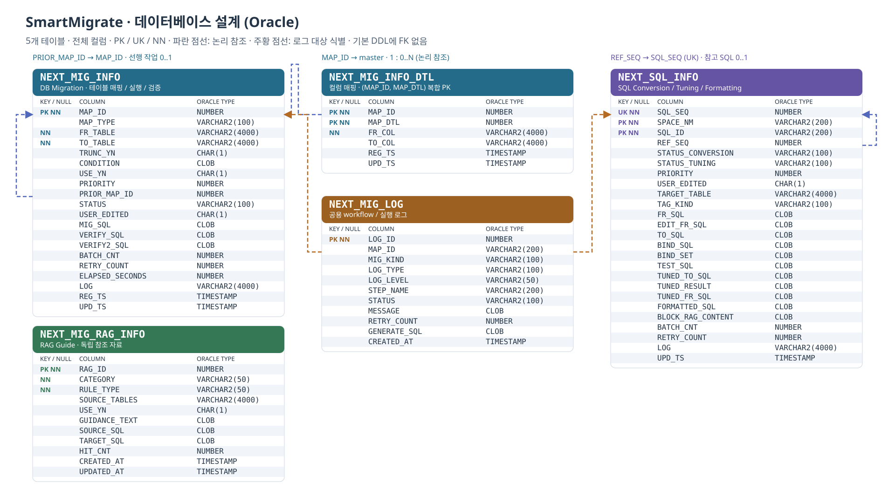
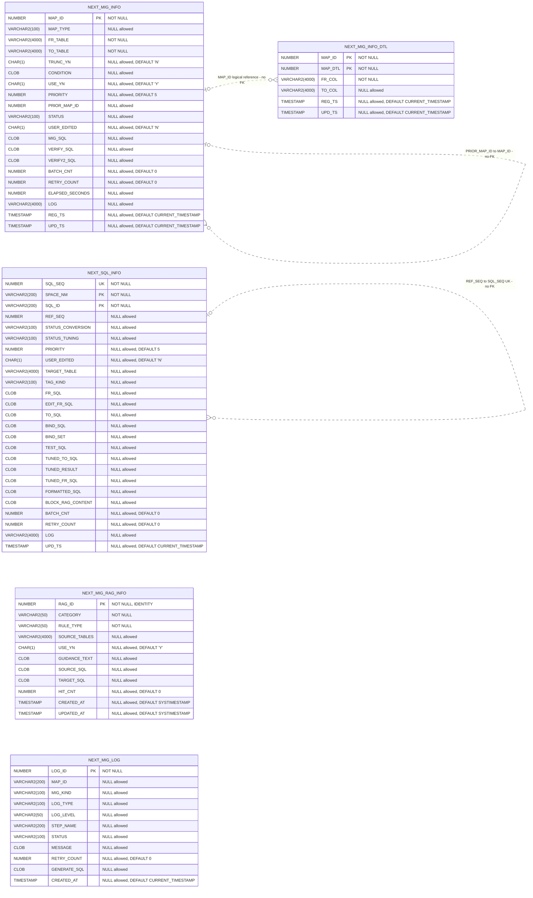
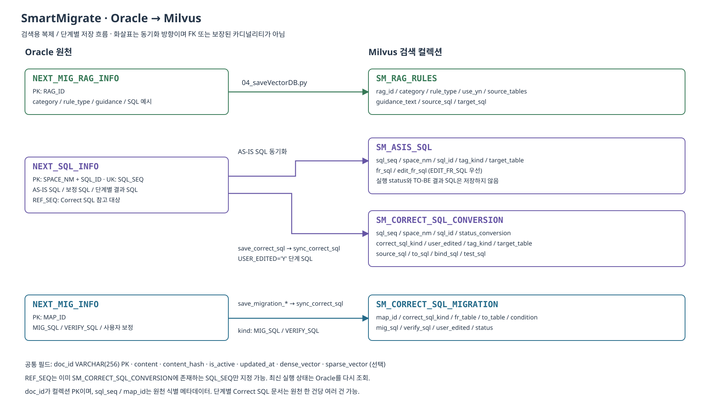
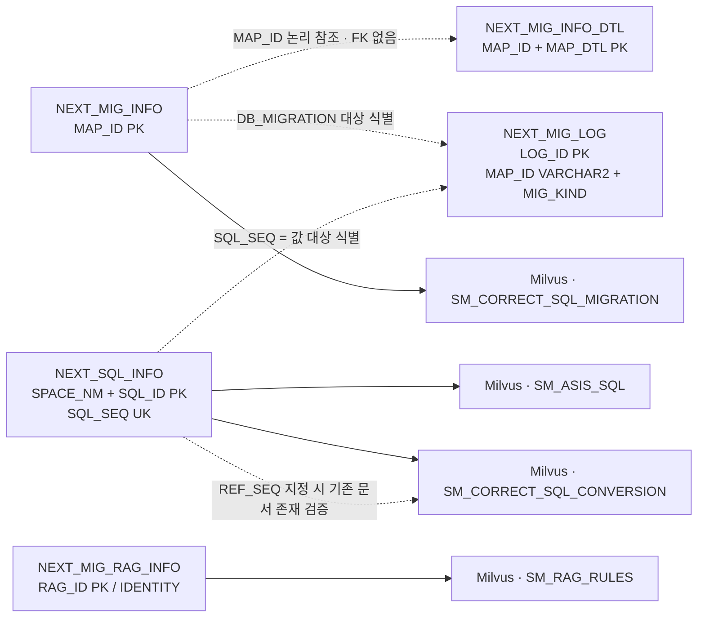

# Chapter 6 ERD — 개발·설계 검토용

기준: [Oracle & Milvus DDL](00_architecture_chapter6_oracle_ddl.md). 운영 DB 실측이 아닌 문서 기준이다.

- [전체 컬럼 Oracle ERD 그림](00_architecture_chapter6_erd.svg)
- [Oracle → Milvus 동기화 그림](00_architecture_chapter6_erd_milvus.svg)
- [확대·축소 가능한 오프라인 뷰어](00_architecture_chapter6_erd.html)
- [수정 가능한 Mermaid 원본](00_architecture_chapter6_erd.mmd)
- [주요 기능 한 장표 — Management / 작업 실행](00_agent_features.svg)

## Oracle 테이블 전체 컬럼



PK는 기본키, UK는 UNIQUE, NN은 NOT NULL이다. 복합 PK로 표시된 컬럼은 함께 하나의 키를 이룬다.
기본 DDL에는 FOREIGN KEY가 **없다**. 파란 점선은 문서에 설명된 논리 참조이고,
주황 점선은 `MIG_KIND` 및 문자열 로그 대상을 해석하는 조건부 연결이다. 참조 컬럼을 FK로 표시하지 않았다.

| 참조 컬럼 | 대상 | 의도한 관계 | DB 강제 여부 |
|---|---|---|---|
| `NEXT_MIG_INFO_DTL.MAP_ID` | `NEXT_MIG_INFO.MAP_ID` | master 1 : detail 0..N | FK 없음. 운영 정책에 따라 별도 추가 가능 |
| `NEXT_MIG_INFO.PRIOR_MAP_ID` | 같은 테이블의 `MAP_ID` | 작업당 선행 0..1, 선행 작업당 후속 0..N | FK 없음, 순환 방지 제약도 문서에 없음 |
| `NEXT_SQL_INFO.REF_SEQ` | 같은 테이블의 `SQL_SEQ` (UK) | SQL당 참조 0..1, 대상 SQL당 피참조 0..N | FK 없음. 자기 자신 참조만 CHECK로 금지 |
| `NEXT_MIG_LOG.MAP_ID` + `MIG_KIND` | Migration `MAP_ID` / SQL `SQL_SEQ` | 해당 작업에 로그 0..N, WORKFLOW 등은 작업 대상이 없을 수 있음 | 문자열 기반 대상 식별. 일반 FK 관계 아님 |

`NOT NULL`은 참조 값의 존재만 보장한다. 참조 대상 row의 존재를 보장하지 않으므로 고아 detail이나 잘못된 참조 값이 저장될 수 있다.
Mermaid는 이 사실을 반영해 논리 참조 대상 쪽을 `0..1`로 표시한다. 의도한 master–detail 관계의 master는 1이다.
Mermaid의 점선은 비식별 관계 기호이므로 **점선 자체가 FK 부재를 뜻하지 않는다**. 각 라벨의 `no FK`와 위 설명이 FK 부재를 명시한다.
master–detail은 `MAP_ID`가 detail PK에 포함되는 논리적 식별 관계지만, 이 문서의 점선은 전체 논리 참조를 구분하기 위한 표현이다.

`NEXT_SQL_INFO`의 PK는 `(SPACE_NM, SQL_ID)`이며 `SQL_SEQ`는 NOT NULL UNIQUE 키다.
`NEXT_MIG_LOG.MAP_ID`는 VARCHAR2(200)이므로 NUMBER 키와 단순 동등 조인하면 안 된다.
DB Migration은 MAP_ID, SQL Conversion/Tuning은 `SQL_SEQ = 값`, Formatting은 `SQL_SEQ = 값` 또는 `MAP_ID = 값`을 사용한다.
`FR_TABLE`, `TARGET_TABLE`, `SOURCE_TABLES`는 table scope 메타데이터다. 이를 일반 FK나 보장된 N:M 관계로 표현하지 않는다.



## Oracle / Milvus 연결 개요

실선은 검색용 동기화 방향이다. Milvus 컬렉션은 Oracle의 FK 대상 테이블이 아니다.
전체 전용 metadata와 공통 필드는 SVG 및 원문 6.8을 참조한다.





Milvus의 PK는 `doc_id`다. `sql_seq`, `map_id`는 Oracle 원천 식별 메타데이터이며 컬렉션 PK가 아니다.
`REF_SEQ` 지정 시 대상 `SQL_SEQ`가 이미 `SM_CORRECT_SQL_CONVERSION`에 있는지 검증한다.
단계별 Correct SQL 문서는 원천 한 건에서 여러 건 생성될 수 있으므로 이를 1:1로 단정하지 않는다.

## 설계 검토 포인트

- 복합 PK와 UK를 분리해서 본다. `SQL_SEQ`로 참조하더라도 기존 SQL 업무키는 복합 PK다.
- FK 부재에 따른 고아 detail, 존재하지 않는 PRIOR_MAP_ID/REF_SEQ의 검증 책임을 확인한다.
- `REF_SEQ <> SQL_SEQ` CHECK는 직접 자기 참조만 금지한다. 여러 row를 거치는 참조 순환은 금지하지 않는다.
- 공용 로그의 문자열 키 규약과 MIG_KIND를 함께 확인한다. 로그 관계에 일반 FK를 추가하는 설계는 현재 구조와 맞지 않는다.
- Milvus는 검색용 복제다. 최신 실행 상태와 재실행 가능 여부는 Oracle에서 판단한다.
- 원문의 RAG SOURCE_TABLES 규칙은 6.5의 “범위가 분명할 때만 입력”과 6.7의 “Conversion은 반드시 입력” 사이에 차이가 있다. ERD에서는 DDL대로 nullable로 표시했으며, 업무 필수 조건은 별도 확인이 필요하다.

## 수정·내보내기 팁

SVG는 브라우저에서 열어 확대하거나 문서/슬라이드에 삽입할 수 있다. HTML 뷰어는 외부 라이브러리 없이 동작하며 인쇄/PDF 저장을 지원한다.
Mermaid를 지원하는 Markdown 미리보기에서 이 문서 또는 `.mmd`를 편집하면 관계도를 다시 그릴 수 있다.
Oracle 타입의 길이, 기본값, CHECK와 인덱스는 원문 DDL을 기준으로 검토한다.
그림은 먼저 키와 참조 관계를 배치하고 상태/SQL 본문/타임스탬프 컬럼을 그 아래에 놓으면 읽기 쉽다.

DDL이 바뀌면 저장소 루트에서 다음 명령으로 산출물을 갱신한다. 테이블 추가나 관계 변경은 생성 스크립트의 레이아웃·관계도 함께 수정해야 한다.

```powershell
python smartMigrate_2.0_Langflow/00_guide/generate_chapter6_erd.py
```
