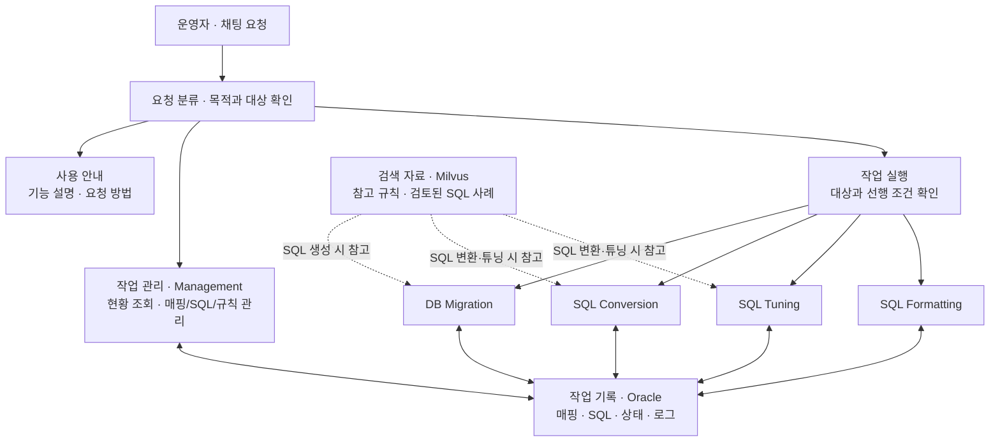

# SmartMigrate 사용자 가이드

SmartMigrate는 채팅으로 DB Migration과 SQL Conversion·Tuning·Formatting 작업을 조회하고 실행하는 에이전트입니다. 테이블·컬럼 매핑을 등록하고, 생성된 SQL과 검증 결과를 확인하며, 실패한 작업을 보정해 다음 단계로 진행할 수 있습니다.

이 가이드는 DB 마이그레이션 업무에는 익숙하지만 SmartMigrate를 처음 사용하는 운영자를 위한 문서입니다. 에이전트의 구성, 첫 작업 순서, 기능별 요청 방법을 설명합니다.

## 1. SmartMigrate로 할 수 있는 일

| 기능 | 운영자가 요청하는 일 | 확인할 결과 |
|---|---|---|
| 매핑룰 템플릿 다운로드 | 매핑정의서 엑셀 양식 생성·다운로드 | 두 시트의 헤더·작성 안내와 실제 다운로드 파일 |
| 매핑 등록·수정 | AS-IS / TO-BE 테이블과 컬럼의 대응 관계 등록 | 매핑 SQL 생성 여부와 실제 DB 반영 여부 |
| 작업 관리 (Management) | 대상 목록, 진행 상태, 결과, SQL, 로그 조회 및 관리값 변경 | 작업 번호, 현재 상태, 실패 원인, 변경 결과 |
| DB Migration | 등록된 매핑을 기준으로 이관 SQL 생성·실행·검증 | INSERT 실행, 건수 검증, 레코드 검증 결과 |
| SQL Conversion | AS-IS SQL을 TO-BE SQL로 변환하고 검증 | 변환 SQL, 바인드 정보, 검증 결과 |
| SQL Tuning | 변환된 SQL의 튜닝과 검증 | 튜닝 SQL과 변경 사유, 검증 결과 |
| SQL Formatting | 실행 흐름에서 생성된 SQL의 서식 정리 | Formatting 대상과 저장된 결과 |
| SQL 보정·참고 자료 관리 | 사람이 검토한 SQL 저장, 유사 SQL 검색, 규칙·사례 관리 | 저장한 SQL 단계, 참고 대상, 검색 자료 동기화 결과 |

처음에는 **작업 현황 조회**로 시작하는 것을 권장합니다. 실행할 대상과 현재 상태를 확인한 뒤 특정 작업을 지정하면 처리 범위를 파악하기 쉽습니다.

## 2. 에이전트는 어떻게 구성되어 있나요?

사용자는 하나의 채팅 창에 요청합니다. SmartMigrate는 요청을 안내, 작업 관리, 작업 실행으로 구분해 해당 기능으로 전달합니다. 내부 에이전트를 사용자가 직접 골라 호출할 필요는 없습니다.



작업 관리는 현재 기록을 조회하거나 지정한 정보를 변경합니다. 작업 실행은 대상과 실행 조건을 확인한 뒤 SQL 생성·실행·검증을 진행합니다. 두 기능은 구분되어 있으므로 **조회하거나 재시도 준비값을 변경했다고 작업이 실행되는 것은 아닙니다.**

Oracle에는 작업의 현재 상태, SQL과 로그가 저장됩니다. Milvus에는 SQL 생성에 참고할 규칙과 검토된 사례가 검색용으로 저장됩니다. 실행 결과는 작업 상태와 실제 로그를 기준으로 확인합니다.

전체 워크플로우를 요청하면 다음 순서로 처리합니다. 특정 단계만 요청할 수도 있지만 해당 단계의 선행 조건을 만족해야 합니다.

```text
DB Migration → SQL Conversion → SQL Tuning → SQL Formatting
```

## 3. 처음 사용할 때의 순서

기존 SQL 작업을 보정하려면 아래 시나리오 2을, 새 매핑을 준비해 이관하려면 시나리오 1를 참고하세요. 먼저 공통 순서를 설명하고, 이어서 그대로 따라 할 수 있는 대화 예시를 제공합니다.

### 1단계. 사용할 환경과 작업 자료 확인

운영 담당자에게 사용할 DB 환경, 작업 데이터의 등록 여부, 실행 가능한 범위를 확인합니다. 이미 작업이 등록되어 있다면 매핑을 다시 등록할 필요 없이 현황 조회부터 시작합니다. 사용자 요청에 DB 비밀번호나 API key를 넣을 필요는 없습니다.

새 Migration 작업에는 테이블·컬럼 매핑이 필요하고, SQL Conversion에는 변환할 AS-IS SQL과 작업 식별자가 필요합니다. 작업 자료가 등록되지 않았다면 매핑은 아래 5절을, SQL 작업의 초기 등록은 해당 환경의 운영 담당자 안내를 따르세요.

### 2단계. 전체 현황과 대상 번호 확인

먼저 다음 문장으로 현재 등록된 작업을 확인하세요.

> 전체 작업의 성공·실패·잔여 건수를 대시보드로 보여줘.

이어 필요한 도메인의 목록을 조회합니다.

> DB Migration의 남은 작업 목록과 MAP_ID, 현재 상태를 보여줘.

> PAYMENT 공간에서 실패한 SQL Conversion 작업의 SQL_SEQ와 상태를 보여줘.

조회 요청은 실제 작업을 실행하거나 상태를 변경하지 않습니다.

### 3단계. 특정 작업의 내용과 실행 조건 확인

아래 번호와 업무 공간·SQL ID는 모두 예시입니다. 실제 조회한 값으로 바꿔 사용하세요.

> MAP_ID 101의 매핑 정보, 현재 상태와 최근 로그를 보여줘.

> SQL_SEQ 42의 AS-IS SQL, Conversion 상태와 최근 실패 원인을 보여줘.

SQL Conversion과 Tuning은 **사용 대상으로 설정된 DB Migration이 모두 완료되어야** 시작할 수 있습니다. SQL 한 건만 지정하더라도 이 조건을 확인합니다. 선행 작업이 남아 있으면 응답에서 안내한 대상과 상태를 먼저 확인하세요.

### 4단계. 범위를 정해 실행 요청

> MAP_ID 101의 Migration을 실행해줘.

> SQL_SEQ 42의 Conversion을 실행해줘.

전체 단계의 남은 작업을 순서대로 처리하려면 다음과 같이 요청합니다.

> 전체 워크플로우의 남은 작업을 실행해줘.

전체 실행은 특정 한 건 실행보다 넓은 범위를 처리합니다. 처음에는 대상 한 건의 처리 흐름과 결과를 확인한 뒤 실행 범위를 넓히는 것을 권장합니다. 완료되었거나 이미 실행 중인 작업은 요청했다고 자동으로 다시 실행되는 것이 아닙니다.

### 5단계. 결과 확인과 후속 조치

> MAP_ID 101의 최근 실행 결과와 건수·레코드 검증 결과를 보여줘.

> SQL_SEQ 42의 Conversion·Tuning 상태와 생성된 SQL을 보여줘.

결과에서 대상 번호, 처리 단계, 성공·실패 상태, 검증 결과와 오류를 확인합니다. 실패하면 원인을 조회한 뒤 SQL 보정이나 재시도 준비가 필요한지 판단합니다. 방법은 아래 7절에서 설명합니다.

### 채팅 시연 구성 · 두 가지 시나리오 (30~40분)

기존에 확인한 일반 안내·대시보드 조회와 템플릿 다운로드·매핑 등록 흐름을 두 이야기로 확장합니다. **시나리오 1(DB Migration) → 시나리오 2(SQL Conversion / Tuning)** 순서로 시연하면 Migration 완료 후 SQL 작업을 진행하는 순서와도 맞습니다. 앞부분은 확인한 흐름이고, Correct SQL·자동 REF_SEQ·후속 실행은 추가 시연에서 확인할 항목입니다.

| 구분 | 시나리오 1 · DB Migration | 시나리오 2 · SQL Conversion / Tuning |
|---|---|---|
| 중심 기능 | 템플릿, 매핑 등록·조회·수정, 실행 대상/우선순위 관리, Migration 검증·Correct SQL | 대시보드, RAG/VectorDB, Conversion Correct SQL, 유사 SQL/REF_SEQ, Tuning/Formatting |
| 이야기 | 새 매핑을 준비해 이관하고, 검증 실패를 확인하여 보정·재실행 | 실패한 SQL 한 건을 보정하고 유사 작업에도 참고 SQL을 연결하여 후속 처리를 진행 |
| 권장 시간 | 15~18분 | 15~18분 |
| 함께 확인할 것 | 다운로드·등록 SQL 생성·DB 반영·이관 실행은 각각 다른 단계 | 저장·검색·REF_SEQ 반영·실행은 각각 다른 단계 |

마무리 전체 현황·전체 워크플로우 설명에 3~4분을 배정합니다. 시간은 설명과 채팅 입력의 배분 예시이며 실제 실행 대기 시간은 환경에 따라 달라집니다. PPT 도식은 [시연 시나리오 장표](00_architecture_chapter6_erd.html#scenarios)와 [16:9 SVG](00_demo_scenarios.svg)를 사용하세요.

#### 시연 전 준비

- 아래 번호·이름은 예시입니다. 실제 대상 번호를 미리 확인하고 모든 채팅 문장에 다시 적습니다. “그거”, “네”만으로 이전 대상을 복원하지 않습니다.
- 시나리오 1: 새 매핑 `MAP_ID 101`과 수정/관리용 별도 작업 `102`를 준비합니다. 테이블매핑과 컬럼 매핑을 모두 작성하고 실제 DB 반영 설정을 확인합니다. 검증 실패 복구 장면에는 INSERT 완료·검증 미완료 상태의 별도 작업 `103`과 사람이 검토한 검증 SQL을 준비합니다. 성공 작업이 반드시 실패할 것이라고 가정하지 않습니다.
- 시나리오 2: 기준 Correct SQL 작업 `SQL_SEQ 42`와 유사 실패 후보 `57` 등, 검토한 SQL 전문, 필요한 BIND_SET을 준비합니다. TO_SQL/BIND_SQL/TEST_SQL 시연은 실패 단계별 별도 작업으로 준비하고 연속 저장으로 상태를 임의로 바꾸지 않습니다. 자동 적용을 보여주려면 AS-IS SQL 유사도 80% 초과이며 종류별 실패 상태가 맞는 후보가 있어야 합니다. 검색·동기화 연결과 AS-IS 검색 자료도 준비합니다.
- SQL Conversion/Tuning 실행 전 사용 대상 Migration이 모두 PASS인지 확인합니다. 먼저 실행한 작업은 상태가 바뀌므로 다음 시나리오에 필요한 미처리/실패 작업을 소진하지 않도록 대상을 구분합니다.

### 시나리오 1. DB Migration · 새 매핑 등록과 이관·검증 실패 보정

**일반 대화 → 템플릿 다운로드·작성 → 매핑 등록·조회 → 작업 실행 → 진행·결과·생성 SQL 조회 → 실패 분석 → Migration Correct SQL → 재실행·검증**

| 단계 | 실제 채팅 예시 또는 행동 | 시연에서 확인할 결과 |
|---|---|---|
| 1. 일반 대화 | `새 테이블 매핑을 등록하고 이관하려면 어떤 순서로 진행하면 돼?` | 안내 → 양식 → 등록 → 확인 → 실행 순서 |
| 2. 템플릿 다운로드 | `매핑정의서 템플릿 보내줘.` | 실제 XLSX 다운로드, DRM 및 AI 생성 안내 |
| 3. 파일 작성 | 두 시트의 3행부터 실제 매핑을 작성합니다. | 테이블매핑 G→MAP_TYPE, I→FR_TABLE; 컬럼 매핑 A/B/D/M→MAP_ID/MAP_DTL/TO_COL/FR_COL. Conversion은 PASS 테이블 매핑이면 컬럼 상세가 없어도 참조하며, 상세가 있으면 컬럼 매핑도 전달 |
| 4. 매핑룰 등록 | 작성한 파일을 첨부하고 아래 고정 요청문을 전송합니다. | SQL 생성과 실제 DB 반영 여부, 성공·실패·미반영 집계 |
| 5. 매핑룰 조회 | `MAP_ID 101의 테이블 매핑과 컬럼 매핑 상세를 보여줘. MAP_TYPE, FR_TABLE, TO_TABLE, CONDITION, TRUNC_YN, PRIOR_MAP_ID와 MAP_DTL, FR_COL, TO_COL을 확인하고 싶어.` | 작성한 필드·부모 연결·상세변환규칙이 실제 저장 값과 일치하는지 확인 |
| 6. 관리·수정 | 별도 시연 대상에 `MAP_ID 102의 PRIORITY를 3으로 변경해줘.` → `MAP_ID 102의 USE_YN을 N으로 변경해줘.` → 조회 → `MAP_ID 102의 USE_YN을 Y로 변경해줘.` | 우선순위·실행 대상 변경과 원복. 매핑 수정 장면은 `MAP_ID 102, MAP_DTL 1의 TO_COL을 [실제 대상 컬럼명]으로 수정해줘.`로 대체 가능 |
| 7. 작업 실행 | `MAP_ID 101의 Migration을 실행해줘.` | 이관 SQL 생성·실행과 건수/레코드 검증 |
| 8. 진행 중 조회 | 별도 채팅/세션에서 `현재 실행 중인 DB Migration 작업과 진행 상태를 보여줘.` | 진행 상태와 실제 대상. 실행 중 채팅이 불가능하면 실행 후 단계별 로그로 대체 |
| 9. 결과·생성 SQL | `MAP_ID 101의 최근 실행 결과와 건수·레코드 검증 결과를 보여줘.` 이어서 `MAP_ID 101의 MIG_SQL, VERIFY_SQL과 최근 실행 로그를 보여줘.` | 이관 결과·검증 수치·생성 SQL. 결과 조회가 재실행으로 연결되지 않음 |
| 10. 실패 분석 | 준비된 검증 실패 대상에 `MAP_ID 103의 실패 단계, 오류, 검증 차이와 저장된 SQL을 보여줘.` | FAIL-TEST 등 실제 상태와 데이터/조건/SQL 오류 구분 |
| 11. Correct SQL 입력 | INSERT를 이미 확인한 경우 `MAP_ID 103의 Correct MIG_SQL을 저장해줘. SQL: [확인된 INSERT SQL 전문]` | FAIL-TEST와 RETRY_COUNT=0, 해당 Correct SQL 동기화. INSERT를 다시 실행하지 않고 검증부터 재개할 준비 |
| 12. 재실행·검증 | `MAP_ID 103의 Migration을 재실행해줘.` 이어서 `MAP_ID 103의 최근 실행 결과와 건수·레코드 검증 결과, 재개 단계의 로그를 보여줘.` | INSERT 반복 없이 검증부터 재개했는지와 최종 결과 확인 |

4단계에서는 파일을 첨부하고 다음 요청문을 그대로 사용합니다.

> Super Agent의 파일 처리 기능을 활용하여 첨부파일의 내용을 조회해줘. Code Interpreter Tool은 사용하지 말고 해당 내용을 빠짐 없이 Smart Migrate 에이전트를 호출하여 전달하고 매핑룰을 등록해줘

템플릿 생성에는 Code Interpreter를 사용하며, 위 요청문의 제한은 작성된 파일의 조회·등록 단계에 적용됩니다. 다운로드나 SQL 생성만으로 DB 반영·이관이 완료되지는 않습니다. DB 미반영이면 운영 담당자에게 적용 설정을 확인한 뒤 다음 단계로 진행하세요.

Migration 검증을 사람이 이미 완료한 별도 사례는 `MAP_ID 104의 Correct VERIFY_SQL을 저장해줘. SQL: [검증 완료한 SQL 전문]` → 해당 MAP_ID 상태·Correct SQL VectorDB 조회로 보여줄 수 있습니다. VERIFY_SQL 저장은 PASS를 의미하므로 재실행 준비용으로 사용하지 않습니다. 단순 retry 복구 장면은 실제 FAIL-*·retry 소진 대상에 `MAP_ID 105의 RETRY_COUNT를 0으로 초기화해줘.` → 상태 확인 → 실행으로 대체합니다. Migration에는 유사 SQL 자동 REF_SEQ 등록 기능이 없습니다.

### 시나리오 2. SQL Conversion / Tuning · SQL 보정과 유사 작업 재실행

**일반 대화 → 대시보드·실패 조회 → RAG·VectorDB 준비 → Correct SQL 저장 → 유사 SQL 검색·REF_SEQ 자동 등록 → 재실행 → Tuning·Formatting → 결과 확인**

| 단계 | 실제 채팅 예시 | 시연에서 확인할 결과 |
|---|---|---|
| 1. 일반 대화 | `SmartMigrate에서 SQL 변환이 실패하면 어떻게 보정하고 다시 진행할 수 있어?` | 기능 설명과 Correct SQL 저장·실행의 차이 |
| 2. 대시보드 | `전체 작업의 성공·실패·잔여 건수를 대시보드로 보여줘.` | 전체 현황과 실패한 도메인 |
| 3. 실패·생성 SQL 조회 | `SQL Conversion의 실패한 작업 목록과 SQL_SEQ, 실패 단계, 오류를 보여줘.` 이어서 `SQL_SEQ 42의 AS-IS SQL, TO_SQL, BIND_SQL, TEST_SQL과 최근 실패 원인을 보여줘.` | 실제 실패 단계·기존 SQL·원인. SQL_ID만 알면 `SQL_ID S001, SPACE_NM PAYMENT의 SQL_SEQ와 Conversion 상태를 보여줘.`로 번호 확인 |
| 4. RAG 등록·조회 | `SQL_CONVERSION SEARCH 사례를 등록해줘. SOURCE_TABLES는 COMM_INFO, GUIDANCE_TEXT는 [실제 적용 조건], SOURCE_SQL은 [원본 SQL 전문], TARGET_SQL은 [검토한 변환 SQL 전문]이야.` 이어서 `방금 등록 결과의 RAG_ID 25 규칙 전문과 USE_YN을 보여줘.` | 실제 등록 결과에서 얻은 RAG_ID로 조회. 대괄호 부분과 25는 실제 값으로 교체 |
| 5. RAG 수정·동기화 | `RAG_ID 25의 GUIDANCE_TEXT를 [수정한 적용 조건]으로 변경해줘.` 이어서 `전체 벡터 DB 동기화해줘.` | RAG/AS-IS 검색 자료 동기화 결과. Correct SQL 전체를 재동기화했다고 해석하지 않음 |
| 6. Correct SQL 입력 | `SQL_SEQ 42의 Correct TO_SQL을 저장해줘. SQL: [검토한 TO-BE SQL 전문]` | 저장 → 해당 Correct SQL 동기화 → 기준 작업의 AS-IS SQL로 유사 실패 작업 검색 → 조건을 만족하는 후보에 REF_SEQ 등록까지 이어지는지 확인 |
| 7. 참조 SQL 반영 조회 | `SQL_SEQ 57의 REF_SEQ, RETRY_COUNT, STATUS_CONVERSION을 보여줘.` 이어서 `SQL_SEQ 42의 Correct SQL을 VectorDB에서 조회해줘.` | 후보의 REF_SEQ=42, RETRY_COUNT=0과 실패 상태 보존. 검색 후보·실제 반영·미반영 이유 구분 |
| 8. 재실행 요청 | `SQL_SEQ 42의 Conversion을 실행해줘.` 이어서 `SQL_SEQ 57의 Conversion을 재실행해줘.` | 기준 작업은 Correct TO_SQL을 재생성하지 않고 Bind부터 재개. 후보는 FAIL-TOBE 상태에서 참조 Correct SQL을 힌트로 사용 |
| 9. 진행 중 조회 | 별도 채팅/세션에서 `현재 실행 중인 SQL Conversion 작업과 진행 상태를 보여줘.` | 실제 실행 중인 작업 조회. 실행 중 채팅이 불가능한 환경이면 실행 후 단계별 로그 조회로 대체 |
| 10. 후속 처리 | `SQL_SEQ 57의 Conversion·Tuning 상태와 FORMATTED_SQL을 보여줘.` Tuning이 남아 있으면 `SQL_SEQ 57의 Tuning을 실행해줘.` Formatting만 남아 있으면 `SQL_SEQ 57의 Formatting을 실행해줘.` | 실행 흐름에서 이미 끝난 단계는 결과 조회로 보여주고 남아 있는 단계만 실행 |
| 11. 결과·SQL·로그 | `SQL_SEQ 57의 최근 실행 결과, TO_SQL, TUNED_TO_SQL, TUNED_RESULT, FORMATTED_SQL과 단계별 최근 로그를 보여줘.` | Conversion 검증·튜닝 변경 사유·포매팅된 SQL. SQL 실행 시간이 반드시 개선됐다고 단정하지 않음 |

**Correct SQL 종류별 자동 REF_SEQ 등록 장면**은 다음 세 가지 중 준비된 데이터를 선택합니다. 상세 시연에서는 각각 독립된 기준 작업과 후보로 보여줄 수 있습니다.

| 입력할 SQL | 실제 채팅 예시 | 기준 작업의 저장 후 상태 | 유사도 80% 초과 후보의 자동 REF_SEQ 등록 조건 |
|---|---|---|---|
| TOBE (`TO_SQL`) | `SQL_SEQ 42의 Correct TO_SQL을 저장해줘. SQL: [검토한 SQL 전문]` | FAIL-BIND, 다음 실행은 Bind부터 | 후보 STATUS_CONVERSION=FAIL-TOBE |
| BIND_SQL | `SQL_SEQ 43의 Correct BIND_SQL과 BIND_SET을 저장해줘. BIND_SQL: [검토한 SQL 전문]. BIND_SET: [실제 바인드 JSON 객체 배열]` | FAIL-TEST, 다음 실행은 Test부터 | 후보 STATUS_CONVERSION=FAIL-BIND |
| TEST_SQL | `SQL_SEQ 44의 Correct TEST_SQL을 저장해줘. SQL: [검증 완료한 SQL 전문]` | PASS-CONVERSION, 이후 Tuning | 후보 STATUS_CONVERSION=FAIL-TEST |

자동 등록은 후보의 REF_SEQ와 RETRY_COUNT만 변경하고 실패 상태를 유지합니다. 저장 종류와 후보 실패 단계가 다르면 적용하지 않습니다. 검색 결과가 없거나 임계값/상태 조건을 만족하지 않으면 0건 사유를 확인합니다. 저장 성공 후 동기화/검색이 실패하면 완료한 단계와 실패한 단계를 구분합니다.

**수동 검색·참고 지정은 대체 장면**입니다. 자동 적용 대상과 겹치지 않는 별도 후보로 다음을 시연하세요.

> SQL_SEQ 42와 AS-IS SQL이 유사한 실패 Conversion 작업을 유사도 80% 이상으로 찾아줘.
>
> SQL_SEQ 58의 참고 Correct SQL을 REF_SEQ 42로 지정해줘.
>
> SQL_SEQ 58의 REF_SEQ와 현재 상태를 보여줘.
>
> SQL_SEQ 58의 REF_SEQ를 해제해줘.

수동 검색은 조회만 수행합니다. REF_SEQ 지정에는 실제 VectorDB의 활성 Correct SQL 문서가 필요합니다. 수동 지정 자체는 자동 적용과 달리 RETRY_COUNT 초기화나 실행을 뜻하지 않습니다. retry 소진 후보라면 `SQL_SEQ 58의 RETRY_COUNT를 0으로 초기화해줘.`를 별도로 요청하고 상태를 확인한 뒤 실행하세요.

Tuning RAG도 보여주려면 4~5단계에서 별도 사례를 추가합니다: `SQL_TUNING SEARCH 사례를 등록해줘. GUIDANCE_TEXT는 [실제 튜닝 조건], SOURCE_SQL은 [원본 SQL 전문], TARGET_SQL은 [검토한 튜닝 SQL 전문]이야.` 동기화 후 관련 Tuning 결과에서 적용 여부를 확인합니다. 시연용 규칙 정리는 마지막에 `RAG_ID 25를 비활성화해줘.` → `전체 벡터 DB 동기화해줘.` → 해당 RAG_ID 조회로 확인합니다.

#### 두 시나리오를 마친 뒤 · 전체 흐름과 예외 대응 (3~4분)

| 장면 | 실제 채팅 예시 | 확인할 결과 |
|---|---|---|
| 전체 결과 요약 | `최근 실행 결과를 도메인별로 보여줘.` | 이번 대상의 실제 로그와 전체 현황을 구분하여 설명 |
| 전체/도메인 실행 | 남은 시연용 작업이 있다면 `전체 워크플로우의 남은 작업을 실행해줘.` 또는 `SQL Tuning의 실행 가능한 작업을 전체 실행해줘.` 중 하나 선택 | 전체는 Migration→Conversion→Tuning→Formatting 순서. 단건 시연에서 완료한 작업은 다시 실행될 것이라고 기대하지 않음 |
| 모호한 요청 | `59번 실행해줘.` | 도메인 확인 질문. 지정하지 않은 전체 작업으로 확대되지 않음 |
| 선행 작업 안내 | 사용 대상 Migration이 미완료인 별도 환경에서 `SQL_SEQ 60의 Conversion을 실행해줘.` | 선행 조건 미충족 안내. 도구 오류를 성공이나 작업 0건으로 설명하지 않음 |

시연 전 체크: 실제 대상·상태와 검토한 SQL 전문 준비, 매핑 DB 반영 설정 확인, 검색 자료 동기화 확인, 단계별 조회 문장 준비. 시연 결과는 실제 응답으로 확인하며 자동 REF_SEQ 적용이나 실행 성공을 미리 보장하지 않습니다.

## 4. 요청할 때는 목적·작업 종류·대상을 함께 적으세요

| 대상 | 사용할 식별자 | 요청 예시 |
|---|---|---|
| DB Migration | `MAP_ID` | `MAP_ID 101의 상태와 최근 로그를 보여줘.` |
| SQL Conversion / Tuning / Formatting | `SQL_SEQ` | `SQL_SEQ 42의 Tuning을 실행해줘.` |
| SQL_SEQ를 모르는 SQL 작업 | `SQL_ID`와 `SPACE_NM` | `SQL_ID S001, SPACE_NM PAYMENT의 상태를 보여줘.` |
| 특정 작업이 아닌 전체 현황 | 도메인 또는 전체 범위 | `최근 실행 결과를 도메인별로 보여줘.` |

`SPACE_NM`은 SQL 작업의 업무 공간 이름입니다. `SQL_ID`만으로는 공간이 다른 작업을 구분하기 어려우므로 공간 이름도 함께 적습니다.

현재 SmartMigrate는 이전 대화의 작업 대상을 자동으로 복원하지 않습니다. 후속 요청에도 작업 종류와 번호를 다시 적어 주세요. 예를 들어 `그거 실행해` 대신 `SQL_SEQ 42의 Conversion을 실행해줘`라고 요청합니다.

특정 업무 공간의 작업을 실행하려면 먼저 목록을 조회하고, 실행할 `SQL_SEQ`를 지정하세요. 최근 결과 조회는 작업 번호를 몰라도 요청할 수 있습니다. 특정 실행 결과가 필요하면 대상 번호나 실행 시각을 함께 적습니다.

## 5. 매핑 등록과 수정

### 매핑룰 템플릿 다운로드와 작성

> 매핑정의서 템플릿 보내줘.

Super Agent가 기존 양식의 구조와 등록 항목을 참고하여 엑셀 파일을 생성합니다. DRM 문제로 원본 템플릿을 직접 제공하는 방식이 아니므로, 다운로드한 파일의 구조와 작성 안내를 검토하세요.

- 시트는 `테이블매핑`, `컬럼 매핑` 두 개입니다. 두 시트 모두 1행은 그룹 제목, 2행은 헤더, 실제 입력은 3행부터입니다.
- 테이블매핑의 필수값은 A 순번(`MAP_ID`), D TO-BE 테이블명(`TO_TABLE`), I AS-IS 테이블명(`FR_TABLE`)입니다. F 변환유형에는 “변환”, G 변환규칙에는 실제 규칙 코드(예: `MR001`)를 입력하며 **G가 `MAP_TYPE`**입니다. L 필터, M TRUNC여부, N 선행완료필요대상순번도 업무 조건에 맞게 작성합니다.
- 컬럼 매핑의 필수값은 A M(`MAP_ID`), B D(`MAP_DTL`), M 상세변환규칙(`FR_COL`)입니다. D TO-BE 컬럼명이 `TO_COL`이며 미사용 컬럼은 공란으로 둘 수 있습니다. **I의 AS-IS 컬럼명이 아니라 M의 상세변환규칙이 `FR_COL`**에 저장됩니다. 이 시트의 테이블명은 참고용이며 부모 연결은 A의 번호로 결정합니다.
- 순번을 임의로 중복 사용하지 마세요. 기존 `MAP_ID`나 `(MAP_ID, MAP_DTL)`과 같으면 신규 등록 대신 수정 대상이 될 수 있습니다. 부모 번호·필수값이 빠진 데이터 행은 채우고, 예시 값은 실제 업무 값으로 교체하세요.

파일 작성 후에는 아래의 파일 첨부 요청으로 등록하고, 저장된 테이블·컬럼 매핑을 조회하여 입력한 값과 비교한 뒤 실행하세요.

### 매핑 본문을 직접 전달하는 경우

테이블 매핑에는 작업 번호와 원본·대상 테이블명을, 컬럼 매핑에는 부모 작업 번호와 상세 순번을 포함합니다. 다음 이름과 번호는 예시입니다.

> MAP_ID 101, FR_TABLE CUSTOMER, TO_TABLE MEMBER를 등록해줘. 컬럼은 MAP_ID 101, MAP_DTL 1, FR_COL CUST_ID, TO_COL MEMBER_ID야.

기존 매핑의 일부만 수정할 수도 있습니다.

> MAP_ID 101의 TO_TABLE을 MEMBER_NEW로 수정해줘.

> MAP_ID 101, MAP_DTL 1의 TO_COL을 MEMBER_ID로 수정해줘.

`MAP_DTL`은 해당 Migration 작업 안에서 컬럼 매핑을 식별하는 상세 순번입니다. 여러 테이블의 매핑을 전달할 때는 각 컬럼이 어느 `MAP_ID`에 속하는지 명확히 적어 주세요.

### 매핑 파일을 전달하는 경우

파일 업로드 기능의 경우 현재 보안 문제로 인해 기능 제한이 있을 수 있습니다. 다음 템플릿을 복사하여 파일을 다시 첨부하고 요청해 주세요!

> Super Agent의 파일 처리 기능을 활용하여 첨부파일의 내용을 조회해줘. Code Interpreter Tool은 사용하지 말고 해당 내용을 빠짐 없이 Smart Migrate 에이전트를 호출하여 전달하고 매핑룰을 등록해줘

위 문장은 Super Agent에 보내는 요청입니다. 로컬 파일 경로만 전달하면 자동으로 내용을 읽을 수 없으므로, 파일 전달이 실패하면 매핑 본문 또는 접근 가능한 다운로드 URL을 제공합니다.

### 등록 결과에서 확인할 것

파일을 읽은 것, 매핑 SQL을 생성한 것, DB에 실제 반영한 것은 서로 다른 결과입니다. 응답에서 생성·적용 여부와 대상별 성공·실패·미반영 건수를 확인하세요.

기본 설정은 매핑 SQL 생성·검증입니다. 실제 DB 반영은 운영자가 설정한 적용 옵션으로 결정됩니다. 채팅에 `적용해줘`라고 적는 것만으로 설정이 바뀌지는 않습니다. SQL은 생성됐지만 미반영으로 표시된다면 운영 담당자에게 해당 환경의 적용 설정을 확인하세요.

## 6. 실행 결과는 어떻게 읽나요?

| 결과 표시 | 운영자가 확인할 의미 | 다음 행동 |
|---|---|---|
| 대기 / 미처리 | 아직 완료되지 않은 작업 | 대상과 선행 조건을 확인한 뒤 실행 요청 |
| `RUNNING` 계열 | 처리 중인 작업 | 진행 상태와 로그 조회 |
| `PASS` | Migration 및 검증 완료 | 검증 결과 확인 |
| `PASS-CONVERSION` | SQL 변환 완료 | Tuning 진행 여부와 결과 확인 |
| `PASS-TUNING` | SQL 튜닝 완료 | Formatting 대상과 결과 확인 |
| `FAIL-*` | 특정 단계에서 실패 | 실패 단계·오류·이전 단계 SQL 확인 |
| 실행 후보 없음 / 선행 조건 미충족 | 요청 범위에 실행 가능한 대상이 없거나 앞 단계가 미완료 | 대상 목록과 실행 불가 사유 확인 |

Conversion이 완료되면 같은 실행 흐름에서 Tuning으로 이어질 수 있으므로 최종 응답에서 실제 처리한 단계를 확인하세요. Formatting은 해당 실행에서 생성된 SQL을 대상으로 하며, DB에 저장된 모든 SQL을 한꺼번에 다시 정리하지 않습니다.

대시보드의 전체 성공·실패 건수는 등록된 작업의 현황입니다. 방금 실행한 작업의 처리 건수와 같다고 볼 수는 없습니다. 특정 실행을 검토할 때는 대상 번호·실행 시각·로그를 함께 확인하세요.

실패 상태별 재개 위치와 자동 실행 조건은 [상세 운영 참고서](00_user_operations_reference.md)에 정리되어 있습니다.

## 7. 실패한 작업을 보정하고 다시 진행하기

먼저 실패 원인을 조회합니다.

> SQL_SEQ 42의 Conversion 실패 단계, 오류와 저장된 SQL을 보여줘.

재시도 횟수가 소진되어 준비가 필요하다면 다음과 같이 요청할 수 있습니다.

> SQL_SEQ 42의 RETRY_COUNT를 0으로 초기화해줘.

이 요청은 재시도 횟수를 초기화합니다. 실패 상태나 선행 조건도 확인해야 하며, 초기화만으로 실제 작업이 실행되지는 않습니다. 준비 결과를 확인한 뒤 실행을 따로 요청합니다.

> SQL_SEQ 42의 Conversion을 재실행해줘.

### 사람이 검토한 SQL 저장 — Correct SQL

Correct SQL은 사람이 검토·확인한 단계의 SQL을 저장하는 기능입니다. **저장한 종류에 따라 해당 단계가 확인 완료된 것으로 처리되고 다음 재개 위치가 바뀝니다.** 초안 보관 용도로 사용하지 마세요.

| 저장할 SQL | 저장이 의미하는 확인 | 이후 진행 |
|---|---|---|
| Migration `MIG_SQL` | INSERT 단계가 이미 사람 확인을 통과함 | 다음 실행은 INSERT를 반복하지 않고 검증부터 재개 |
| Migration `VERIFY_SQL` | Migration 검증까지 완료함 | Migration 완료 처리 |
| Conversion `TO_SQL` | 변환 SQL을 확인함 | 다음 실행은 바인드 단계부터 재개 |
| Conversion `BIND_SQL` + `BIND_SET` | 바인드 SQL과 값 정보를 확인함 | 다음 실행은 테스트 단계부터 재개 |
| Conversion `TEST_SQL` | Conversion 검증까지 완료함 | Conversion 완료 처리 |

예를 들어 검토한 변환 SQL을 저장하려면 대상 번호, SQL 종류와 SQL 전문을 함께 전달합니다.

> SQL_SEQ 42의 Correct TO_SQL을 저장해줘. SQL: [검토한 SQL 전문]

대괄호 부분을 실제 SQL로 바꾸고, 한 번에 한 종류를 저장하세요. `BIND_SQL` 저장에는 `BIND_SET`도 필요합니다. 빈 바인드 값은 현재 저장 도구에서 허용되지 않으므로 해당 사례는 운영 담당자에게 확인하세요.

저장 결과에서는 **DB 저장, 검색 자료 동기화, 실제 작업 실행**을 각각 확인하세요. Correct SQL 저장 후에는 해당 종류의 검색 자료 동기화가 수행되지만, 저장 자체는 다음 단계 실행 요청이 아닙니다. 다음 단계 실행이 필요하다면 대상 번호와 도메인을 지정해 따로 요청하세요. 상세 상태 전이는 [운영 참고서의 Correct SQL 설명](00_user_operations_reference.md)을 참조하세요.

SQL Conversion의 Correct `TO_SQL`·`BIND_SQL`·`TEST_SQL`을 저장하면 동기화 성공 후 해당 작업의 AS-IS SQL을 기준으로 유사 실패 작업을 자동 검색합니다. 유사도가 80%를 초과하고 저장 종류와 실패 단계가 일치하는 작업(`TO_SQL`→`FAIL-TOBE`, `BIND_SQL`→`FAIL-BIND`, `TEST_SQL`→`FAIL-TEST`)에는 저장한 작업의 `SQL_SEQ`를 `REF_SEQ`로 지정하고 `RETRY_COUNT=0`으로 준비합니다. 결과에서 검색 후보·실제 반영 대상·미반영 사유를 확인하세요. 후보의 실패 상태는 유지하며 자동 실행하지 않습니다. Migration Correct SQL에는 이 자동 적용 흐름이 없습니다.

## 8. 참고 규칙과 유사 SQL 활용

### 변환·튜닝 규칙 등록 — RAG Guide

RAG Guide는 SQL 생성 시 참고할 공통 규칙이나 변환·튜닝 사례입니다. 프로젝트 규칙과 적용 조건을 명확히 전달할 때 사용합니다.

SQL Conversion의 SEARCH 규칙은 활성 규칙 중 원천 테이블 범위가 겹치는 규칙을 **개수 제한 없이 모두** 참고합니다. 각 규칙의 가이던스와 원본·변환 SQL 사례가 변환 프롬프트에 포함됩니다. 변환 검증의 “최대 3개”는 바인드 케이스 수이며, RAG 규칙 개수 제한이 아닙니다.

> SQL Tuning 사례를 등록해줘. GUIDANCE_TEXT는 [적용 조건], SOURCE_SQL은 [원본 SQL], TARGET_SQL은 [튜닝 SQL]이야.

> RAG_ID 25의 규칙 내용을 [새 규칙]으로 수정해줘.

대괄호 부분은 실제 내용으로 바꿉니다. 등록·수정한 규칙을 검색 자료에 반영하려면 별도로 동기화를 요청하세요. 규칙 변경만으로 동기화나 기존 작업 재실행이 이루어지지는 않습니다.

> RAG Guide와 Correct SQL을 VectorDB에 동기화해줘.

### 비슷한 실패 SQL 검색과 참고 대상 지정

SQL Conversion에서는 AS-IS SQL이 유사한 실패 작업을 찾을 수 있습니다. 검토된 SQL 사례를 다른 작업의 참고 대상으로 지정할 때 활용합니다.

> SQL_SEQ 42와 AS-IS SQL이 유사한 실패 Conversion 작업을 찾아줘.

검색된 후보의 대상 번호, 실패 단계, 테이블과 유사도를 검토한 뒤 적용 대상을 지정합니다. 다음 예시는 42번의 Correct SQL 저장과 동기화가 완료되어 있고, 57번의 실패 단계에 사용할 수 있는 경우의 요청입니다.

> SQL_SEQ 57의 참고 Correct SQL을 REF_SEQ 42로 지정해줘.

`REF_SEQ`는 참고할 SQL 작업 번호입니다. 참고 대상으로 지정해도 SQL 전문을 그대로 복제하거나 작업을 즉시 실행하지 않습니다. 이후 실행에서 해당 단계의 힌트로 활용합니다. 유사 SQL 검색·일괄 반영은 SQL Conversion 기능이며 DB Migration에는 제공되지 않습니다.

## 9. 자주 겪는 상황과 다음 요청

| 상황 | 권장 행동 또는 요청 |
|---|---|
| 무엇부터 할지 모르겠음 | `전체 작업의 성공·실패·잔여 건수를 보여줘.` |
| SQL 작업 번호를 모름 | `SQL_ID S001, SPACE_NM PAYMENT의 상태와 SQL_SEQ를 보여줘.` |
| 최근 실행 결과를 보고 싶음 | `최근 마이그레이션 10건의 상태와 검증 결과, 실패 원인을 보여줘.` |
| Conversion 실행이 선행 작업 때문에 막힘 | 사용 대상 Migration의 미완료 목록·상태·로그 확인 |
| 재시도 준비 후에도 실행되지 않음 | 대상 상태와 실행 조건 확인 후 별도 실행 요청 |
| Correct SQL 저장 후 검색되지 않음 | 해당 SQL 종류의 동기화 결과 확인 |
| 응답에서 실행 완료 여부를 알 수 없음 | 대상 번호로 상태·최근 로그 재조회 |
| DB 조회나 연결이 실패함 | 결과를 재조회하고, 반복되면 요청 시각·대상 번호·오류 요약을 운영 담당자에게 전달 |

조회 실패는 작업이 0건이거나 실행이 실패했다는 뜻이 아닙니다. 완료 여부가 불명확할 때는 먼저 실제 상태와 로그를 확인한 뒤 재실행을 결정하세요.

## 10. 상세 자료

- [상세 운영 참고서](00_user_operations_reference.md): 자동 실행 조건, 실패 상태별 재개 위치, Correct SQL 상태 전이, RAG 입력 조건과 모델 연결 설정
- [아키텍처 가이드](00_architecture.md): 내부 컴포넌트와 실행 흐름
- [Oracle / Milvus ERD 뷰어](00_architecture_chapter6_erd.html): 작업 테이블과 검색 자료의 연결 구조

사용자는 자연어로 목적과 대상을 전달하면 됩니다. 내부 메시지 형식이나 모델 endpoint를 요청문에 작성할 필요는 없습니다. 환경 구성과 연결 설정은 운영·개발 담당자가 별도로 관리합니다.
