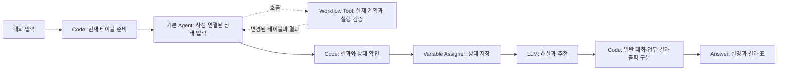

# SmartMigrate 3.0 Dify 대화 시연

**최신 Dify 시연:** 바인드가 있는 두 테이블 SQL 한 개, NEXT_MIG_RAG_INFO 기반 튜닝, 요청별 작업 목록 순차 실행입니다. 현재 Azure/LiteLLM 경로는 ReAct의 stop 파라미터를 거부하므로 Function Calling을 사용합니다. [stop 오류 원인과 적용](docs/GPT55_STOP_ERROR.md), [시연·로그 진단·DSL 적용](docs/RAG_TUNING_DEMO.md)을 확인하세요.

**조회·일반 대화 보완:** SQL 변환 대상 조회는 NEXT_SQL_INFO의 FR_SQL만 표시합니다. 인사·Agent 소개·기능 질문은 CHAT으로 처리하며 Tool 결과 없음 오류를 붙이지 않습니다. [현재 동작과 SQL 호출 진단](docs/LOOKUP_AND_CHAT.md).

기본 **Agent + 통합 실행 Workflow Tool 하나**로 작업합니다. 01이 실제 이관·SQL 처리·관리를 실행하며 02는 대화 상태와 결과 표시를 관리합니다. 현재 기준은 [REFACTORING.md](REFACTORING.md), 최신 배포 절차는 [입력 자동 구성 가이드](docs/AUTO_INPUT_SETUP.md)입니다.

Oracle 연결, 임베딩, 벡터 DB, 외부 API 서버, 사용자 제작 plugin이 없습니다. Dify에 등록된 모델과 기본 노드만 사용합니다. 기본 Agent가 사용하는 공식 Agent strategy는 Dify 환경에 준비되어 있어야 합니다.

대상 버전은 **Dify 1.15**, DSL은 0.6.0입니다. Agent는 request만 작성하고 현재 테이블은 session_json에 사전 연결돼 있습니다. Tool 목록은 편집기 호환성을 위해 고정 객체 배열입니다. request 자동 ON/session_json 자동 OFF를 유지하며 수동 JSON 입력은 필요 없습니다. 서버 렌더링은 미검증입니다.

## 시작 파일

**DSL 파일 불러오기로 시작하려면 [IMPORT.md](IMPORT.md)를 먼저 보세요.**

| 파일 | 용도 |
|---|---|
| [설치·시연 가이드](docs/SETUP.md) | Dify 가져오기, Tool 연결, 대화 예시 |
| [통합 Tool DSL](dsl/01_smartmigrate_tool.yml) | Workflow 앱으로 가져와 Tool로 발행 |
| [메인 Chatflow DSL](dsl/02_smartmigrate_chatflow.yml) | Agent·대화 상태·결과 표 |
| [테이블별 파일·연결표](samples/TABLE_INPUTS.md) | 별도 JSON 원본 9개와 메인 Chatflow 시작 입력 |
| [통합 샘플](samples/hr_demo.json) | 테이블별 원본에서 생성한 전체 JSON |
| [테이블 정의](samples/table_definitions.json) | 컬럼과 기본 키 확인 |
| [오프라인 결과 표](samples/offline_full_result.md) | 고정 SQL로 실행한 결과 예시 |
| [기술 계약](docs/CONTRACT.md) | 상태·작업·오류·지원 범위 |
| [검증 기록](docs/VALIDATION.md) | 확인한 항목과 Dify 서버 미검증 항목 |

사용하는 DSL은 01 통합 Tool과 02 메인 Chatflow 두 개입니다. 02에는 사용자가 알려준 gpt-5.5와 실제 Workflow Tool ID를 반영했습니다. 중복 03은 제거했습니다. 다른 워크스페이스에서는 모델·Tool 연결을 해당 환경 값으로 갱신해야 합니다. 실제 서버의 실행 성공은 아직 미확인입니다.

## 구성



Tool 내부는 `Start → 상태 준비 Code → 계획 LLM → 실제 실행·검증 Code → End`입니다. 02는 고정 Tool 목록에서 initialize.session_transport를 session_json에 사전 연결합니다. V3 전달 문자열은 원본 JSON 치환으로 배열 파싱이 깨지는 것을 방지합니다. Agent 답변 문장으로 상태를 덮어쓰지 않습니다.

## 샘플과 기능

- 직원 10명·부서 3개, ASIS/TOBE 4개 테이블.
- 기존 계약의 `NEXT_MIG_INFO`, `NEXT_MIG_INFO_DTL`, `NEXT_SQL_INFO`, `NEXT_MIG_RAG_INFO`, `NEXT_MIG_LOG` 유지.
- 매핑 2개와 컬럼 규칙 10개, `NEXT_SQL_INFO.FR_SQL`에 직원·부서 조회 SELECT 한 개 사전 입력. :dept_id·:min_salary, Oracle (+) 조인, PK IN 서브쿼리를 포함합니다.
- 키 기준 이관 추가/갱신 및 레코드 비교. 변환·튜닝·포매팅 산출물을 기존 SQL 작업 행에 반영.
- 대화로 조회·매핑 추가/수정/삭제·작업 상태/SQL 변경·참고 규칙 편집·JSON 내보내기.
- 같은 대화에서 상태 유지. 새 대화는 초기 샘플로 시작하며 대화 간 공유 DB는 없습니다.

## 로컬 검증과 재생성

현재 저장소 루트에서 실행합니다. 이미 제공된 DSL·JSON을 Dify에서 사용하는 데 로컬 Python 설치는 필요 없습니다.

```powershell
python -m pip install -r smartMigrate_3.0_Dify/requirements-dev.txt
python smartMigrate_3.0_Dify/scripts/build.py
python -m unittest discover -s smartMigrate_3.0_Dify/tests -v
python smartMigrate_3.0_Dify/scripts/demo.py
```

데이터 수정은 `samples/tables/*.json`에서 합니다. `build.py`는 원본을 읽어 통합 샘플과 DSL을 재생성하며 테이블별 원본을 덮어쓰지 않습니다. 저장한 모델/Tool 연결은 workspace_binding.json에서 읽어 재생성 시 유지합니다. Dify 화면에서 별도로 수정한 내용은 export로 보관하세요. 소스 변경 후 DSL도 재생성해야 반영됩니다.

로컬 demo는 고정 SQL fixture로 동작합니다. LLM의 자연어 해석이나 Dify 서버 실행을 검증한 결과는 아닙니다.
